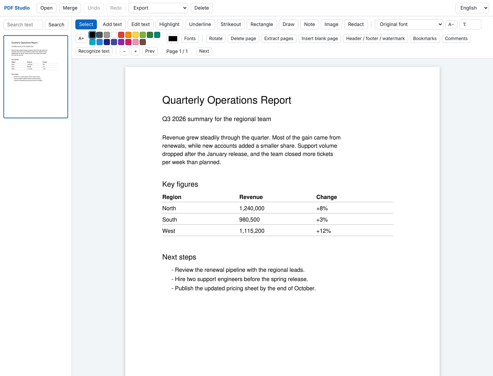
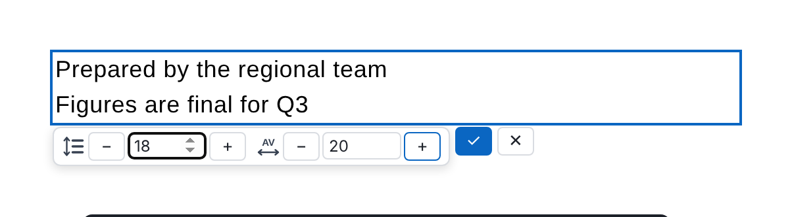
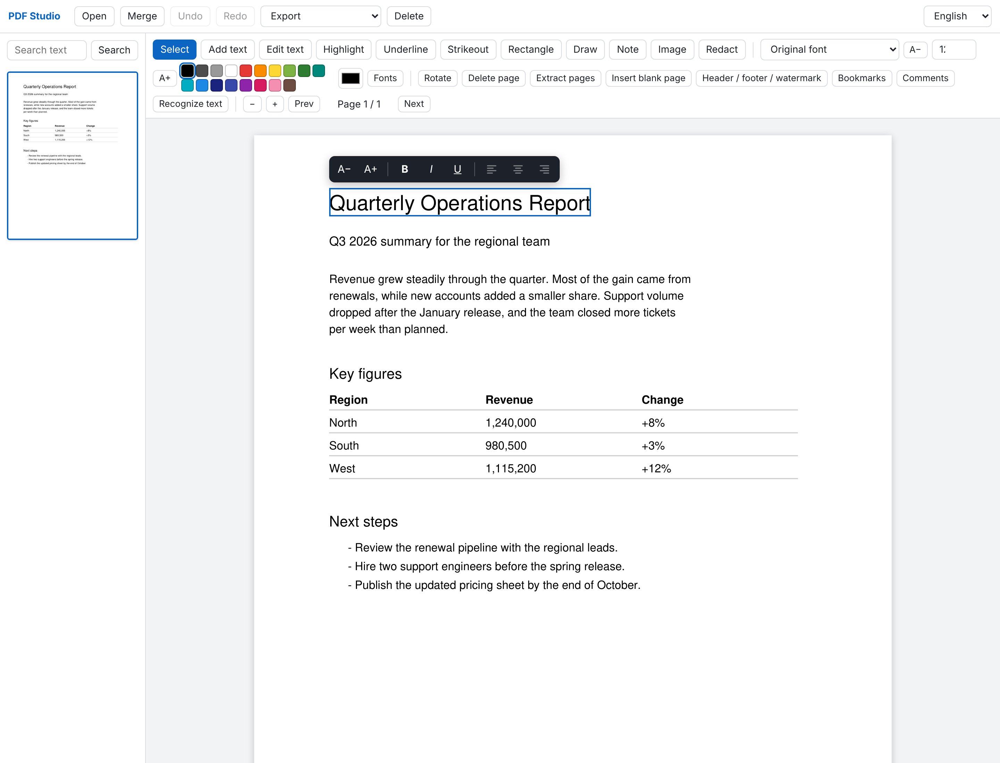

# PDF Studio

PDF Studio is a PDF editor that runs on your own computer. You open it in a browser tab, edit your files there, and save them back to PDF. Nothing is uploaded anywhere. The server only listens on your machine.

It started as a way to change a few lines in a PDF without paying for a full desktop suite, and it has grown into a fairly complete editor. It can change existing text, add text and pictures, mark up pages, manage pages, and export to several formats.



## What it does

**Text**

- Click any line to edit it. Fonts, size, color, bold, italic, and underline all work on edited text.
- Add new text anywhere on a page. Text can be left, center, or right aligned.
- Set letter spacing (kerning) and line spacing for new text.
- Copy and paste text blocks, or move them with the mouse.
- Search the document and jump to the matches.



**Pictures and marks**

- Add PNG or JPEG images, then move and resize them.
- Highlight, underline, strike out, draw rectangles, and draw freehand lines.
- Add sticky notes and comments.
- Redact an area to remove the text under it.

**Pages**

- Rotate, delete, insert blank pages, and extract a range of pages.
- Merge several PDFs into one.
- Add headers, footers, and page numbers, or a watermark.
- Edit bookmarks.
- Undo and redo. The history is saved with the document, so it still works after a reload.



**Fonts**

- Use the built-in fonts (Helvetica, Times, Courier, and a Simplified Chinese font).
- Upload your own TrueType (.ttf) fonts and use them in new text.

**Export**

- PDF
- Read-only PDF, with optional passwords and limits on printing, copying, and editing. Note that PDF readers decide how much of this they enforce.
- Word (.docx). This needs the optional `pdf2docx` package.
- Plain text (.txt)
- The current page as a PNG
- All pages as a ZIP of PNG files

**Scanned pages**

- Recognize text on a scanned page with the optional OCR package. The text becomes a hidden layer, so the page looks the same and the text can be searched and selected.

## Requirements

- macOS. The launcher scripts use macOS commands (`open`, `shasum`, `lsof`). The app itself should also run on Linux if you start it by hand.
- Python 3.9 or newer. OCR needs Python 3.12 or older.
- A modern browser. Chrome, Edge, Safari, and Firefox all work.

## Install and start

Double-click `start.command`. The first run makes a `.venv` folder, installs the packages, and opens the app. The first run needs internet. After that you don't need it.

Terminal version:

```bash
cd pdf-studio
python3 -m venv .venv
.venv/bin/python -m pip install --require-hashes -r requirements.txt
.venv/bin/python -m uvicorn app.main:app --host 127.0.0.1 --port 8000
```

Then open <http://127.0.0.1:8000> in your browser.

To stop the app, run `stop.command`. The server also stops by itself a little after the last browser tab is closed.

### OCR (optional)

OCR isn't installed by default. If you want it, run `install-ocr.command` after the first start. It needs internet and it's a big download. Then run `stop.command` and start the app again.

### How the packages are pinned

`requirements.in` is the wish list. `requirements.txt` is the exact pinned version of it, with hashes. The launcher only installs from the pinned files. Word export (`pdf2docx`) is in the main list.

## Where your files go

Documents, uploaded fonts, and the undo history are kept in a `data` folder inside the project. If you want the data somewhere else, set the `PDF_STUDIO_DATA` environment variable before you start the app. See [PRIVACY.md](PRIVACY.md) for details.

## Running the tests

The tests use pytest for the API and Playwright with Chromium for the browser tests.

```bash
.venv/bin/python -m pip install --require-hashes -r tests/requirements-dev.txt
.venv/bin/python -m playwright install chromium
.venv/bin/python -m pytest tests -q
```

The browser tests start their own copy of the server, so you can run them while the app is open.

## Security

The server only listens on your computer, but a web page you visit in another tab could still try to send it requests. To block that, every change request (upload, edit, delete, export) must carry a custom header that only PDF Studio's own pages send, and its `Origin` must be `127.0.0.1` or `localhost`. Other sites get a 403. Reading pages and files is not affected.

## Updating packages

Only when you change something in a `.in` file.

```bash
python3 -m pip install uv
uv pip compile requirements.in --universal --python-version 3.9 --generate-hashes --no-header -o requirements.txt
uv pip compile requirements-ocr.in --universal --python-version 3.9 --generate-hashes --no-header -o requirements-ocr.txt
uv pip compile tests/requirements-dev.in --universal --python-version 3.9 --generate-hashes --no-header -o tests/requirements-dev.txt
```

Then run the tests.

## Known limits

- Letter spacing adds the same gap after every character. It does not use the font's kerning pairs.
- Line spacing applies to new multi-line text. When you edit one existing line, the line keeps its own spacing.
- Bold and italic detection for OCR text is a rough estimate. Check the result on important pages.
- With OCR installed, both `opencv-python` and `opencv-python-headless` end up in the environment. They are the same version and work together, but it is untidy.
- Python 3.9 gets PyMuPDF 1.26.5 instead of 2.1, which only supports 3.11 and newer. The tests pass with both. Most test runs were on Python 3.13.
- Large files take longer to render. Pages are cached, so scrolling gets faster after the first view.

## Project layout

```
app/                 Python backend (FastAPI and PyMuPDF)
static/              Browser front end (HTML, CSS, ES modules in static/js)
static/locales/      English and Simplified Chinese text
tests/               pytest and Playwright tests, with sample PDFs
docs/                Screenshots for this README
start.command        Starts the app on macOS
stop.command         Stops the app
install-ocr.command  Adds OCR (optional)
requirements*.in     What the app needs
requirements*.txt    Pinned versions, with hashes
```

## Contributing

Bug reports and small fixes are welcome. Please open an issue first if you plan a larger change, so we can talk about the approach before you spend time on it.

## Privacy

PDF Studio does not send your files or any usage data anywhere. Read [PRIVACY.md](PRIVACY.md) for the full details.

## License

PDF Studio is released under the GNU Affero General Public License v3.0. See [LICENSE](LICENSE).

PDF Studio depends on PyMuPDF, which is available under AGPL-3.0 or a commercial license from Artifex. Because of that, this project is distributed under AGPL-3.0 as well. The other dependencies and their licenses are listed in [THIRD_PARTY.md](THIRD_PARTY.md).

Version 1.0.0
